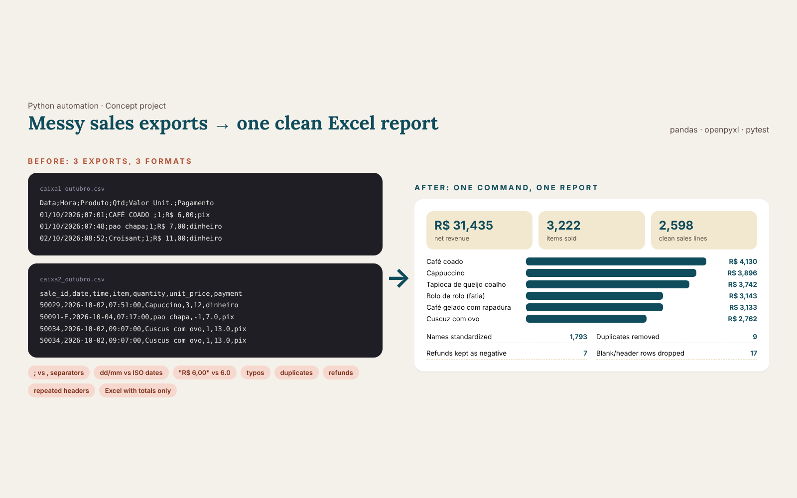
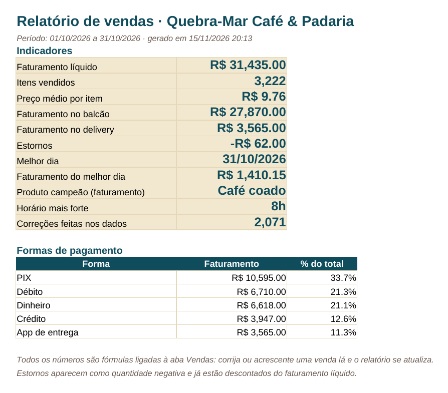

# Café sales report automation (Python)

> **Concept project.** Built for the fictional Quebra-Mar Café & Padaria (Recife). The sales data is generated by `scripts/make_sample_data.py`, but it reproduces problems found in real small-business exports.



## The problem
A café sells through two registers and a delivery app. Every month the owner gets three exports that don't match:

| Source | Format problems |
|---|---|
| Register 1 (`caixa1_outubro.csv`) | `;` separator, `dd/mm/yyyy` dates, prices like `R$ 6,00`, the same product typed many ways (`CAFÉ COADO `, `cafe coado`), blank lines, the header repeated in the middle of the file |
| Register 2 (`caixa2_outubro.csv`) | `,` separator, ISO dates, prices like `6.0`, typos (`Capuccino`, `Croisant`), sales exported twice, refunds as negative quantities |
| Delivery app (`delivery_outubro.xlsx`) | Excel file, one date-time column, only the line total (no unit price), different column names |

Putting these together by hand takes hours and is easy to get wrong.

## The solution
One command reads every file in a folder, fixes the problems and builds an Excel report:

```bash
pip install -r requirements.txt
python -m sales_report data/raw -o reports/relatorio-vendas.xlsx --csv reports/vendas-limpas.csv
```
```
Reading 3 file(s): caixa1_outubro.csv, caixa2_outubro.csv, delivery_outubro.xlsx
2598 clean sales · 12 products · 31 days · 2071 corrections logged
Report saved to reports/relatorio-vendas.xlsx
```

### What the cleaning does
- Detects the separator and maps different column names (`Produto` / `item`, `Qtd` / `quantity`…) to one standard layout
- Reads Brazilian and international price and date formats, and converts prices to cents internally so totals never have rounding errors
- Standardizes product names: accents, capitalization and spaces, then a list of known misspellings, then fuzzy matching for typos. Anything it can't match is **kept and flagged** for review, never silently dropped.
- Removes duplicated sales, using the receipt ID when the export has one
- Keeps refunds as negative values, so revenue is net
- Calculates the unit price when a source only gives the line total
- **Logs every change** (file, row, original value, fixed value, reason) in a "Correções" sheet, so the owner can audit it

### The Excel report (`reports/relatorio-vendas-outubro-2026.xlsx`)
| Sheet | Contents |
|---|---|
| Resumo | Net revenue, items sold, average price, counter vs delivery, refunds, best day, top product, peak hour, payment methods |
| Por produto | Items and revenue per product, share of revenue, bar chart |
| Por dia | Daily revenue and items, line chart |
| Por hora | Revenue per hour and average per open day, bar chart |
| Vendas | The clean data as an Excel table (filterable) |
| Correções | The full cleaning log |

Every number in the summary sheets is an **Excel formula** pointing at the clean data, not a pasted value. If the owner fixes or adds a sale in the `Vendas` sheet, the whole report updates.



## Tests
```bash
python -m pytest
```
29 tests cover price, date and time parsing, product and payment-method name matching, and an end-to-end run with duplicates, refunds, repeated headers, blank lines and an Excel source.

## Project structure
```
sales_report/
  catalog.py     product list, categories, known misspellings
  cleaning.py    loading, parsing, standardizing, deduplication, change log
  report.py      Excel report with formulas and charts (openpyxl)
  __main__.py    command line
scripts/make_sample_data.py   generates the messy demo exports
data/raw/                     the demo exports
reports/                      generated report and clean CSV
tests/                        pytest suite
```

## Adapting it to another business
Edit `catalog.py` (products, categories, common misspellings) and, if the exports use other column names, add them to `COLUMN_ALIASES` in `cleaning.py`.
